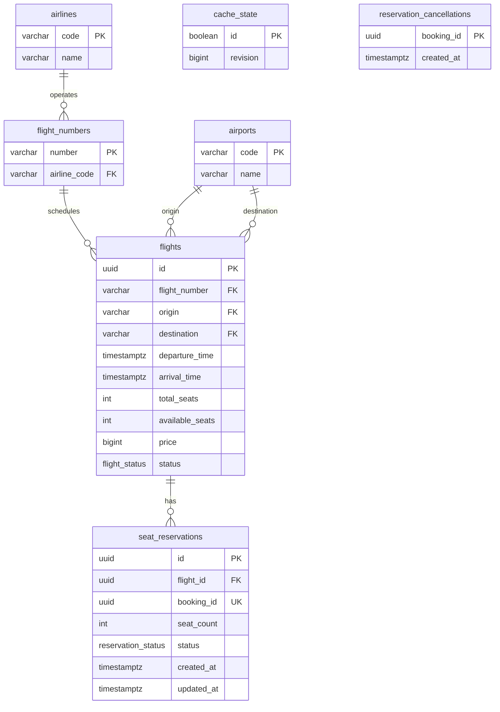
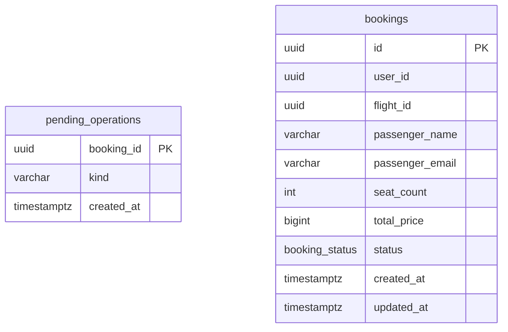

# Схема данных и ошибки gRPC

## ER и 3NF

Диаграммы двух БД

**Flight PostgreSQL**

**Booking PostgreSQL**

Названия авиакомпаний и аэропортов вынесены в справочники; неключевые поля зависят от ключа своей таблицы. Стоимость и данные пассажира в Booking — исторический снимок. Ссылки между БД логические, без SQL FK; одному успешному Booking соответствует один резерв с UNIQUE(booking_id).

CHECK гарантирует положительные цену/вместимость и `0 ≤ available_seats ≤ total_seats`. Номер рейса вместе с датой вылета по UTC уникален. Согласованность остатка и резервов поддерживается транзакцией.

## Ошибки gRPC

| Код | Причина |
| --- | --- |
| INVALID_ARGUMENT | Неверные параметры |
| NOT_FOUND | Рейс или резерв не найден |
| RESOURCE_EXHAUSTED | Недостаточно мест |
| FAILED_PRECONDITION | Рейс недоступен для резерва, резерв завершён или создание отменено |
| ALREADY_EXISTS | booking_id повторён с другими параметрами |
| UNAUTHENTICATED | Нет корректного API Key |
| UNAVAILABLE / DEADLINE_EXCEEDED | Недоступность зависимости / истёк deadline |
| INTERNAL | Неожиданная ошибка Flight |

[Отображение в HTTP](../services/booking/flight_client.py#L14): 400/404/409 для ошибок запроса, 502 для неверного ответа или сервисного ключа, 503/504 для недоступности/таймаута.
